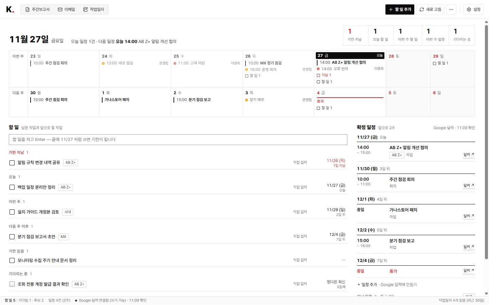
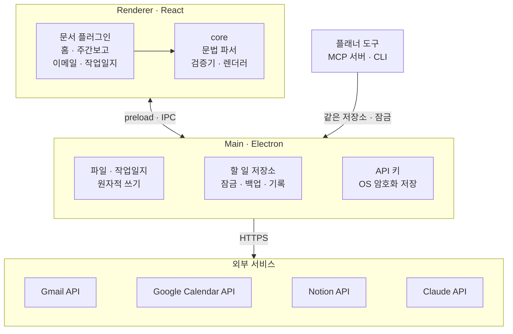
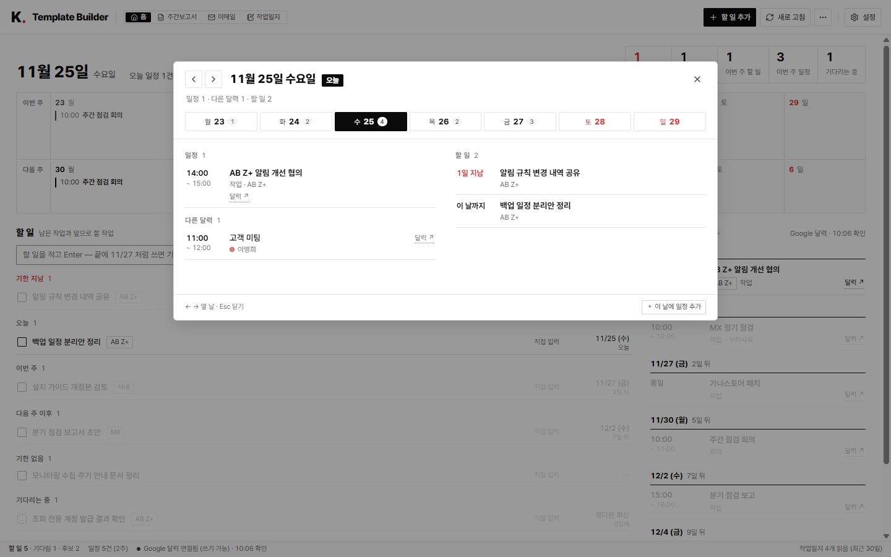
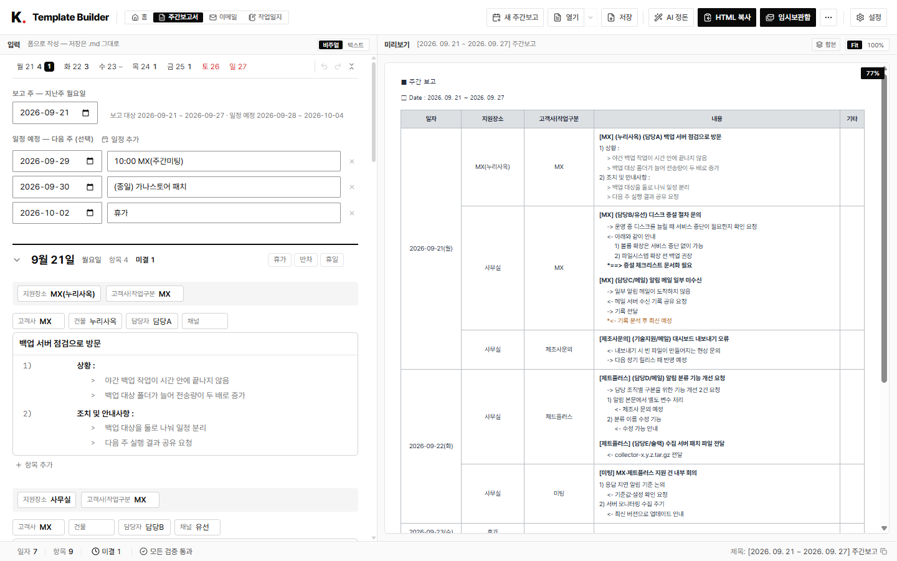
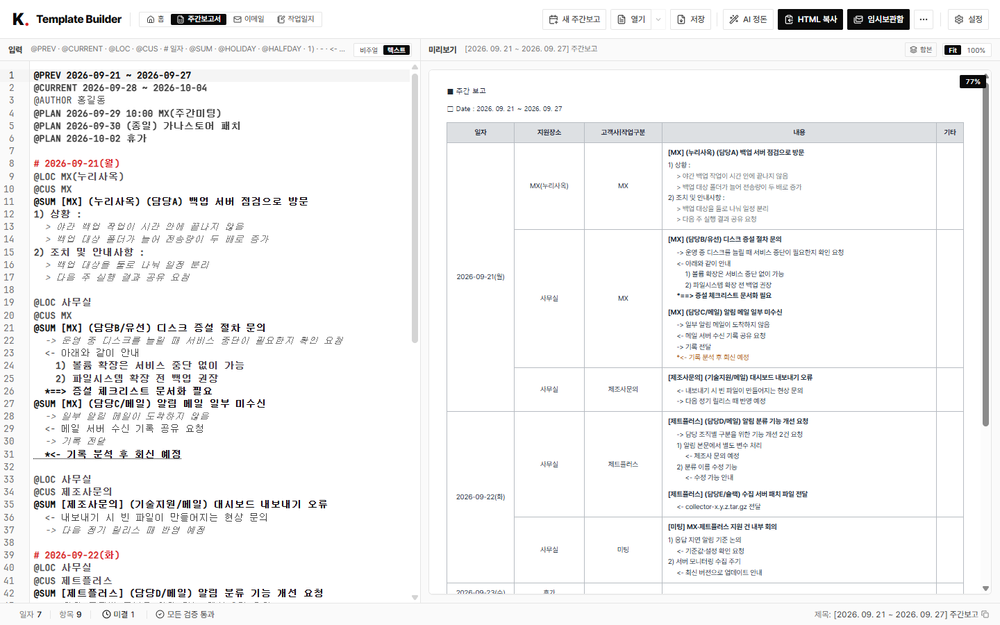
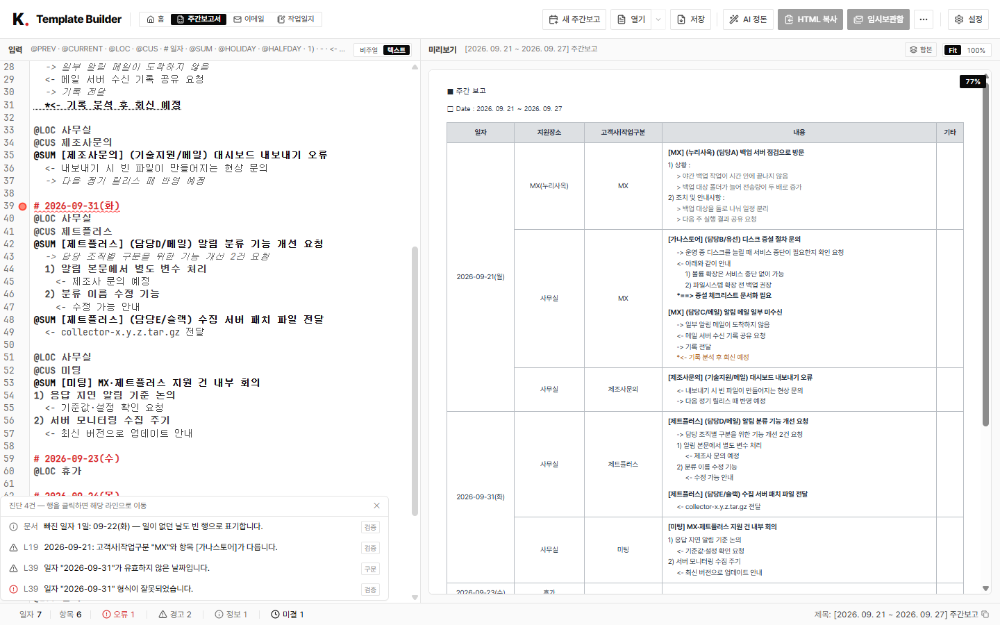
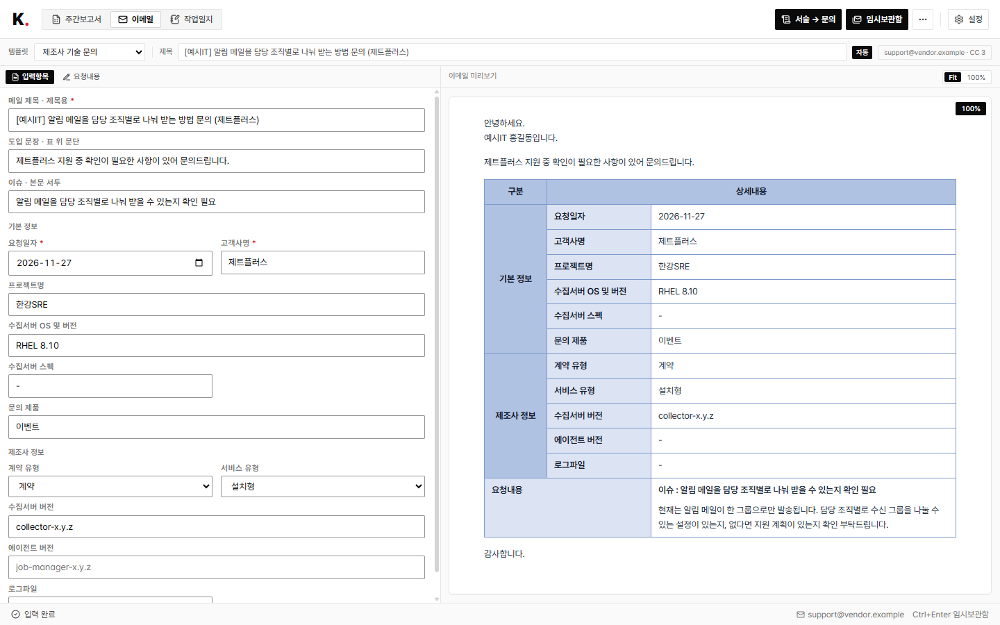
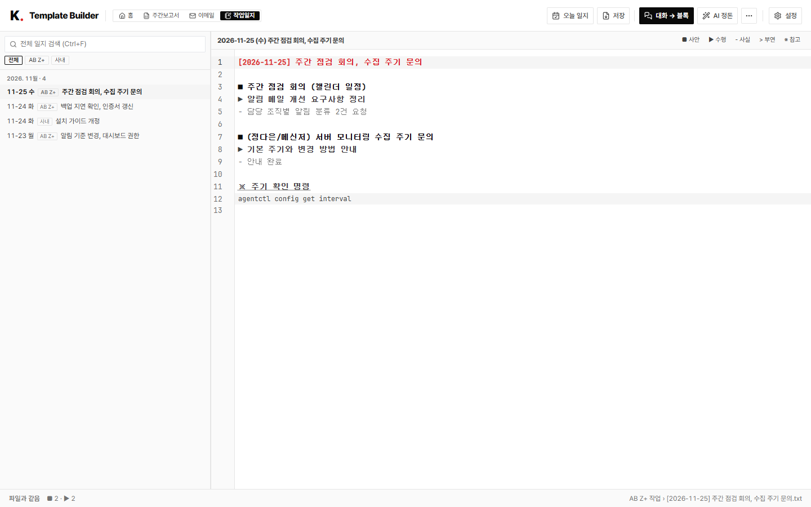

# TemplateBuilder

[](https://github.com/coqute/template-builder/actions/workflows/ci.yml)

주간보고·반복 이메일·작업일지를 **정해진 형식으로 쓰고, 검증하고, 메일 초안까지 만드는** Windows 데스크톱 앱

[](https://www.electronjs.org/)
[](https://react.dev/)
[](https://www.typescriptlang.org/)
[](https://vite.dev/)
[](https://tailwindcss.com/)
[](https://codemirror.net/)
[](https://vitest.dev/)

[](https://developers.google.com/gmail/api)
[](https://developers.google.com/calendar)
[](https://developers.notion.com/)
[](https://platform.claude.com/docs)
[](https://modelcontextprotocol.io/)



<sub>화면에 보이는 고객사·사람 이름·일정은 모두 합성 자료입니다.</sub>

## 목차

- [소개](#소개)
- [아키텍처](#아키텍처)
- [주요 기능](#주요-기능)
- [스크린샷](#스크린샷)
- [프로젝트 구조](#프로젝트-구조)
- [시작하기](#시작하기)
- [테스트와 공개 검사](#테스트와-공개-검사)
- [변경 이력](#변경-이력)
- [이 저장소에 대해](#이-저장소에-대해)

## 소개

기술 지원 업무에서 매주·매일 반복되는 문서 작업을 줄이려고 만들어, 실제 업무에 쓰고 있는 앱입니다.

- 주간보고를 전용 문법으로 쓰면 **메일에 붙일 표**가 되고, 틀린 날짜와 빠진 날은 보내기 전에 걸러집니다.
- 자주 보내는 메일은 **서식 하나를 채우는 일**이 됩니다.
- 하루하루 적은 작업일지가 그 주의 **주간보고 초안**이 됩니다.
- 남은 작업과 달력 일정은 **홈 화면 한 곳**에서 봅니다.

## 아키텍처



- **문서 종류는 플러그인** — 화면 하나가 모듈 하나입니다. 모듈이 자기 상태·툴바·단축키를 갖고, 목록에 등록하면 탭이 생깁니다(`src/doctypes`).
- **문법은 한 곳** — 주간보고 문법(`src/core`)을 텍스트 편집기의 강조·자동완성·린트, 비주얼 편집기, 메일 렌더러, 검증 CLI가 함께 씁니다.
- **바깥과 닿는 일은 Main만** — 파일·네트워크·API 키는 Main 프로세스에만 있고, 화면은 preload가 내준 함수만 부릅니다.
- **저장소 하나, 쓰는 쪽 둘** — 할 일 저장소를 앱과 플래너 도구(MCP)가 잠금으로 나눠 씁니다. 바깥에서 고친 것은 앱에 "바뀜"으로 표시되고 되돌릴 수 있습니다.

앱이 실행 중에 호출하는 외부 API와 쓰는 곳입니다.

| 외부 API | 쓰는 곳 |
|---|---|
| **Gmail API** | 주간보고·이메일을 Gmail 임시보관함 초안으로 만들기 |
| **Google Calendar API** | 홈의 일정 읽기, 일정 만들기·옮기기·지우기 |
| **Notion API** | 홈에서 고른 DB의 최근 변경 페이지 읽기 |
| **Claude API** | 이메일의 서술 → 문의 글, 작업일지의 대화 → 일지 블록, AI 문장 정돈 |

## 주요 기능

| 기능 | 설명 |
|---|---|
| **홈** | 할 일을 기한별로 묶어 Google 달력의 2주 일정과 나란히 봅니다. 날 칸을 누르면 그날의 일정·할 일이 펼쳐지고, 팀·동료 달력은 달력 색으로 구분됩니다. 작업일지의 열린 사안과 Notion DB의 최근 변경도 함께 보여 줍니다. |
| **주간보고** | 전용 `.md` 문법이나 비주얼 편집기로 쓰고, 쓰는 동안 검증합니다(주 범위 밖 일자·고객사 불일치·빠진 일자). 메일용 HTML 표·평문으로 복사하거나 Gmail 임시보관함 초안으로 만듭니다. |
| **이메일** | JSON으로 정의한 서식을 폼으로 채우고 본문에 표·이미지를 넣습니다. 인라인 이미지가 든 Gmail 초안으로 만듭니다. |
| **서술 → 문의** | 편하게 적은 글이나 붙여 넣은 대화를 고른 서식의 칸(제목·도입 문장·본문·표의 빈 칸)에 맞는 글로 바꿉니다. 서술에 없는 내용은 만들지 않고 빠진 것을 알려 주며, 결과를 고친 뒤 고른 것만 서식에 넣습니다. |
| **작업일지** | 폴더의 `[YYYY-MM-DD] 제목.txt`를 그 자리에서 읽고 씁니다. 형식 검사와 전체 검색, 대화 → 일지 블록, 한 주의 일지 → 주간보고. |
| **AI 문장 정돈** | 주간보고·작업일지에서 줄의 종류·순서는 그대로 두고 문장만 다듬습니다. 보내기 전에 IP·URL·메일 주소·키 문자열을 가리고, 바뀔 곳을 항목별로 비교해 고른 것만 반영합니다. |
| **플래너 MCP** | 앱 밖의 MCP 클라이언트나 명령줄에서 할 일과 작업일지 사안을 다룹니다. |
| **내용 보호** | 원자적 쓰기, 밖에서 바뀐 파일의 덮어쓰기 확인, 자동 저장이 충돌하면 보관본, 되돌리기. |

## 스크린샷

| 홈 · 그날 미리보기 | 주간보고 · 비주얼 편집 |
|:---:|:---:|
|  |  |
| **주간보고 · 텍스트 편집** | **주간보고 · 검증** |
|  |  |
| **이메일 서식** | **작업일지** |
|  |  |

## 프로젝트 구조

```
src/
  core/        주간보고 문법 — 파서·직렬화·렌더러(HTML/평문)·검증기
  codemirror/  텍스트 편집기의 문법 강조·자동완성·린트
  doctypes/    화면 플러그인(홈·주간보고·이메일·작업일지)과 레지스트리
  planner/     홈 — 할 일 동작·묶기·작업일지 후보·달력 일정 분류
  email/       서식(JSON) 로더·렌더러·HTML 정화
  worklog/     작업일지 형식·린트·검색·주간보고 변환
  ai/          AI 요청 만들기(서술 → 문의·대화 → 블록·문장 정돈)·마스킹·응답 검증
  components/  툴바·상태바·설정 등 공용 화면
electron/      Main 프로세스 — IPC, 파일, Gmail·달력·Notion·AI 호출, 할 일 저장소, 플래너 도구
scripts/       아이콘 빌드, 주간보고 검증 CLI, 플래너 도구 실행기, 공개 검사
tests/         Vitest 단위·통합 테스트 (fixture는 합성 데이터)
```

주간보고 문법의 예시는 `assets/sample-week.md`, 정의는 `src/core/grammar.ts`, 검증 규칙은 `src/core/validator.ts`에 있습니다.

## 시작하기

Windows와 Node.js 24에서 확인했습니다.

```bash
git clone https://github.com/coqute/template-builder.git
cd template-builder
npm ci
npm run dev
```

| 명령 | 하는 일 |
|---|---|
| `npm run dev` | 개발 실행 |
| `npm run typecheck` | 타입 검사(renderer·main) |
| `npm test` | 테스트 |
| `npm run build:electron` | Windows 설치 파일 → `release/` |
| `npm run verify:weekly -- <파일>` | 주간보고 `.md`를 앱과 같은 파서·검증기로 확인 |
| `npm run planner:tool -- tools` | 플래너 도구 목록 (`mcp`를 주면 MCP 서버로 실행) |

문서를 쓰고 검증하고 복사하는 기능은 연동 없이 동작합니다. 연동은 필요한 것만 켭니다.

- **Gmail · Google 달력** — OAuth 클라이언트 자격증명을 사용자 폴더의 `.template-builder/gmail-credentials/`에서 읽습니다.
- **AI 문장 정돈 · Notion** — 키를 앱 설정에서 입력하면 OS 암호화로 저장합니다.

저장소에는 자격증명이나 키가 들어 있지 않습니다.

## 테스트와 공개 검사

- `npm run typecheck`와 `npm test`는 push마다 GitHub Actions(Windows)에서 돕니다.
- **공개 검사**(`scripts/public-guard.mjs`)는 실데이터가 커밋에 섞이는 것을 막습니다. 메일 주소와 IP(예시용 값만 허용), 프로젝트 코드 모양 값, 사용자 경로, 사람 이름 모양, 저장소 밖에 둔 비공개 용어 사전을 찾고, 결과는 값 없이 **종류·파일·건수만** 출력합니다.
- 검사는 `pre-commit`·`commit-msg`·`pre-push` 훅으로 돕니다. 용어 사전의 위치를 알려 주지 않으면 훅이 커밋을 막습니다.

```bash
git config guard.termsFile "<저장소 밖의 사전 JSON 경로>"
npm run guard            # 작업 폴더 전체
npm run guard:history    # 모든 커밋
```

## 변경 이력

버전별 변경은 [CHANGELOG.md](CHANGELOG.md)에 있습니다.

## 이 저장소에 대해

업무용 원본에서 **코드 구조만** 공개하려고 만든 사본입니다.

- 고객사·사람 이름·메일 주소·IP·내부 URL은 모두 합성 값으로 바꿨습니다(예: `AB Z+`, `홍길동`, `*.example`, `192.0.2.x`). 테스트 fixture와 스크린샷도 합성 자료입니다.
- 회사 전용 기능과 업무 밖 기능은 뺐고, 메일 서식과 제품 이름은 일반 예시로 바꿨습니다.
- 커밋 이력은 같은 규칙으로 다시 쌓았습니다. 이후 변경은 원본에서 공개 규칙을 거쳐 `sync:` 커밋으로 들어옵니다.
